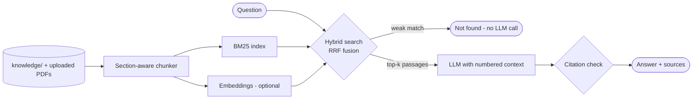

# RAG Telecom Knowledge Assistant

**A retrieval-augmented (RAG) assistant for international roaming and IREG troubleshooting. It answers from your documents, cites every claim, and says "I could not find this" instead of guessing.**

Ask things like *"The ULA came back with 5004, what does that mean?"* or *"Both CS and PS attach fail on the same test SIM, what do I check first?"*. The assistant retrieves the relevant passages and answers with `[n]` citations to them.

It ships with a small knowledge base of roaming study notes. You can add your own PDFs (3GPP specs, internal runbooks) in the UI.

---

## Why this project

Roaming and IREG analysts constantly look up reject causes, Diameter result codes and GSMA procedures spread across long specifications. A plain chatbot invents cause codes with confidence, which is dangerous in network operations. This project shows how to make an LLM **answer only from trusted sources, show where each fact came from, and refuse when the answer isn't there**.

## Features

| Area | What it does |
|---|---|
| **Section-aware chunking** | Splits Markdown / text / PDF by headings, so each chunk stays on one topic and keeps its title and section for citations. |
| **Hybrid retrieval** | Combines BM25 keyword search with optional dense embeddings using Reciprocal Rank Fusion. Keywords matter in telecom: `5004`, `IR.21`, `EMM #14` and `S6a` are exact identifiers that embeddings tend to blur. A custom tokenizer keeps them intact. |
| **Grounded answers** | The prompt requires `[n]` citations on every claim. Each answer is post-checked, and missing or out-of-range citations are flagged as *not grounded*. |
| **Abstention** | If retrieval finds nothing relevant, it answers "not found" **without calling the LLM**, which also saves cost. |
| **Evaluation** | Offline retrieval eval (Hit@1, Hit@k, MRR) plus optional answer eval (grounded rate, keyword coverage). |
| **Any model** | OpenAI, Anthropic Claude or a local Ollama model, through LangChain `init_chat_model` / `init_embeddings`. |
| **UI** | Streamlit chat with an expandable sources panel and document upload. There's also a CLI. |

## Architecture



```
rag-telecom-knowledge-assistant/
├── rag/
│   ├── loader.py      # md / txt / pdf loading, heading-aware chunking
│   ├── bm25.py        # dependency-free BM25 with a telecom-aware tokenizer
│   ├── retriever.py   # hybrid retrieval (BM25 + embeddings, RRF), save / load index
│   ├── answer.py      # grounded prompt, citation validation, abstention
│   └── models.py      # LLM / embedding factory (OpenAI, Claude, Ollama)
├── knowledge/         # 8 roaming study-note documents (IREG, IR.21, EMM/ESM, Diameter, MAP, architecture...)
├── eval/              # 16 labelled questions + eval script
├── tests/             # pytest suite with fake LLM / embedder (no API key needed)
├── app.py             # Streamlit chat
└── cli.py             # terminal chat
```

## Quick start

```bash
git clone https://github.com/Pranil1599/rag-telecom-knowledge-assistant.git
cd rag-telecom-knowledge-assistant
python -m venv .venv && source .venv/bin/activate     # Windows: .venv\Scripts\activate
pip install -r requirements.txt
cp .env.example .env                                   # add an API key, pick a model

streamlit run app.py
# or
python cli.py "What does EMM cause 14 mean during LTE roaming?"
```

No API key yet? You can still explore retrieval:

```bash
python cli.py --sources-only "Diameter 3002 during IREG LTE test"
pytest -q
python eval/run_eval.py
```

## Evaluation

```bash
python eval/run_eval.py              # retrieval only, offline
python eval/run_eval.py --answers    # + LLM answers: grounded rate and keyword coverage
```

Current retrieval results (BM25 only, 16 questions, k = 4):

| Metric | Score |
|---|---|
| Hit@1 | 100% |
| Hit@4 | 100% |
| MRR | 1.00 |

These numbers come from a small question set written against a small corpus, so they show the pipeline works. They are not a benchmark. The next step is a larger and harder question set (see the roadmap).

## Knowledge base and accuracy

The documents in `knowledge/` are **original study notes** summarising concepts from public GSMA (IR.21, IR.23/24/35/38, IR.88, IR.92) and 3GPP (TS 24.008, TS 24.301, TS 29.272, TS 29.002) material. They are for learning and demonstration. **Always verify against the official specifications** before using an answer operationally. No GSMA or 3GPP text is copied, and no operator-confidential data is included.

## Roadmap

- [ ] Grow the eval set to 50+ questions, including harder multi-hop and "not answerable" cases
- [ ] Re-ranking with a cross-encoder
- [ ] Ingest freely available 3GPP specs (TS 24.301, TS 29.272) and compare chunking strategies
- [ ] Answer-level eval with an LLM judge for faithfulness

## Credits

Built by **Pranil Sonawane**. The design draws on public RAG patterns, including the LangChain RAG tutorials and the telecom RAG research in [Telco-RAG](https://arxiv.org/abs/2404.15939) and [Chat3GPP](https://arxiv.org/abs/2501.13954).

## License

MIT
